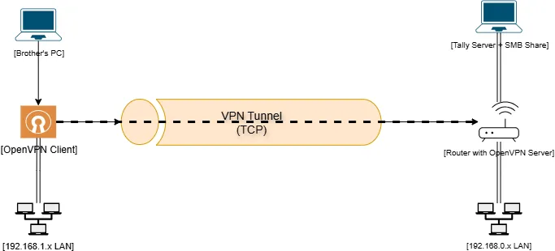

# Remote Access over OpenVPN: SMB Shares & Tally Prime

Secure remote access setup using **OpenVPN**, **Windows SMB** and **Tally Prime license-server routing**, built and troubleshot across two home networks in different cities.

> **Scope:** A hands-on networking project built for learning and real-world use. Config files in this repo are sanitised samples. They contain no keys, certificates or real public IPs.

---

## Overview

A remote user's PC, more than 200 km away, needed to reach shared folders and a Tally Prime license server hosted on my home PC. I designed and deployed an OpenVPN tunnel between the two networks, configured authenticated SMB access and firewall rules, and worked through routing and session failures using Windows Event Viewer.

**Skills demonstrated:** OpenVPN (TCP) · static routing across subnets · Windows Firewall rules · SMB with credentialed access · Event Viewer log analysis · systematic troubleshooting

---

## Network Architecture



| Item | Value |
|---|---|
| VPN subnet | `10.8.0.0/24` |
| Host LAN (Tally server + shares) | `192.168.0.0/24` |
| Remote LAN | `192.168.1.0/24` |
| Protocol | OpenVPN over TCP, port `1194` |
| MTU tuning | `tun-mtu 1400`, `mssfix 1360` |

---

## What I Configured

**VPN**
- OpenVPN server and client with certificate-based authentication
- TCP transport chosen for reliable large-file transfers (see troubleshooting)
- Routes pushed for both LANs

**SMB file sharing**
- Dedicated Windows user (`vpnuser`) with read/write access to the shared folders
- Network drives mapped from the remote side using credentials

**Tally Prime license server**
- `TallyGatewayServer.ini` set to `ServerPort=10000`, `ServerBind=0.0.0.0`
- Port 10000 allowed in Windows Firewall, scoped to the VPN subnet

**Routing**
- Static route on the host PC: `192.168.1.0` / `255.255.255.0` via `10.8.0.14` (the remote client's VPN address)
- IP forwarding enabled on the remote PC to allow LAN-to-LAN traffic

---

## Security Considerations

- **Least-privilege access:** a dedicated, credentialed `vpnuser` account replaced anonymous Guest access.
- **Scoped firewall rules:** rules allow traffic only from the VPN subnet `10.8.0.0/24`. Details are in [`firewall-rules.md`](firewall-rules.md).

---

## Troubleshooting Log

Full notes are in [`troubleshooting-logs.md`](troubleshooting-logs.md).

| Symptom | Diagnosis | Resolution |
|---|---|---|
| SMB transfers failed with "socket closed" errors | Event Viewer showed SMB sessions terminating prematurely ([evidence](screenshots/eventLogs.png)) | Replaced Guest access with the dedicated `vpnuser` account |
| Large file transfers unstable over the tunnel | UDP transport dropped long-running transfers | Switched OpenVPN from UDP to TCP, after which media files transferred and played back successfully |
| Remote LAN unreachable | Static route was created with the subnet as its gateway | Corrected the gateway to the remote client's VPN IP (`10.8.0.14`) and enabled IP forwarding on the remote PC |

---

## Current Status

| Component | Status | Notes |
|---|---|---|
| VPN tunnel | ✅ Working | TCP-based, stable across the distance |
| SMB access (mobile) | ✅ Working | Via a mobile file manager with credentials |
| SMB access (remote PC) | ⚠️ Partial | Drive mapping fails because of Windows credential handling |
| Routing to remote LAN | ✅ Working | Static route and IP forwarding in place |
| Tally license access | ❌ Open | Port 10000 is reachable, but the license fetch does not complete |

---

## Repository Structure

```
vpn-remote-access-tally/
├── README.md
├── configs/
│   ├── server.ovpn              # sanitised sample
│   ├── client.ovpn              # sanitised sample
│   └── TallyGatewayServer.ini
├── firewall-rules.md
├── troubleshooting-logs.md
└── screenshots/
    ├── NetworkArchitectureDiagram.webp
    └── eventLogs.png
```

---

## What I Learned

- How routing, firewall scope and VPN transport choices interact across two private subnets
- How Windows SMB handles sessions and authentication, and what failed sessions look like in Event Viewer
- Isolating a fault layer by layer (tunnel, routing, firewall, application) instead of changing several things at once
- Documenting a problem, its diagnosis and its fix so that someone else can reproduce it
