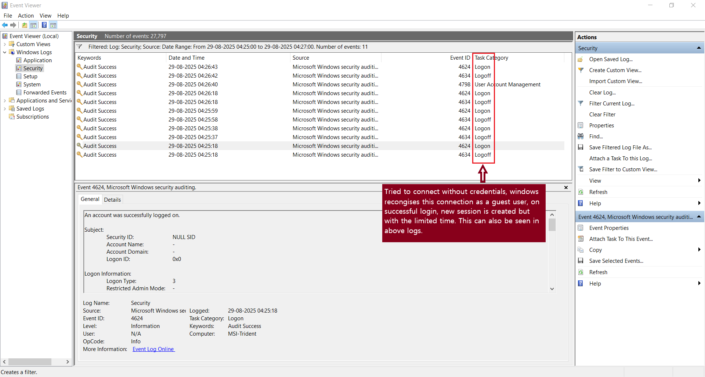

# Troubleshooting Log: VPN + SMB + Tally Access

This log documents the step-by-step troubleshooting process for diagnosing and resolving issues in the remote access setup.

---

## Timeline of Events

### August 29, 2025 
- **Issue**: Media file transfer failed with “socket closed” error
- **Tool Used**: Event Viewer
- **Finding**: SMB sessions were short-lived due to Guest account limitations

<!-- screenshot: Insert Event Viewer log showing SMB logon/logoff -->

---

### August 29, 2025
- **Action**: Created `vpnuser` account with read/write access
- **Result**: Authentication succeeded, but file transfer still failed

---

### August 29, 2025
- **Action**: Switched OpenVPN protocol from UDP to TCP
- **Result**: Large file transfers succeeded; media playback stable

---

### August 29, 2025
- **Issue**: Brother’s PC could ping the Tally server but not fetch the license
- **Finding**: Port 10000 not reachable due to a missing firewall rule

---

### August 30, 2025
- **Action**: Added static route to reach `192.168.1.0/24` via `10.8.0.14`
- **Finding**: Route worked, but IP forwarding was disabled on the remote PC

---

## Outstanding Issues

- ✅ SMB access from brother’s PC still fails due to Windows credential handling. To resolve the issue, I created a new user account in Windows with credentials.
- ❌ Tally license fetch pending final verification

---

## Confirmed Successes

- ✅ VPN tunnel is stable and secure
- ✅ SMB access from mobile device works flawlessly
- ✅ Event logs and firewall rules validated

<!-- screenshot: Insert screenshot of successful ping, mapped drive, or Tally config -->
